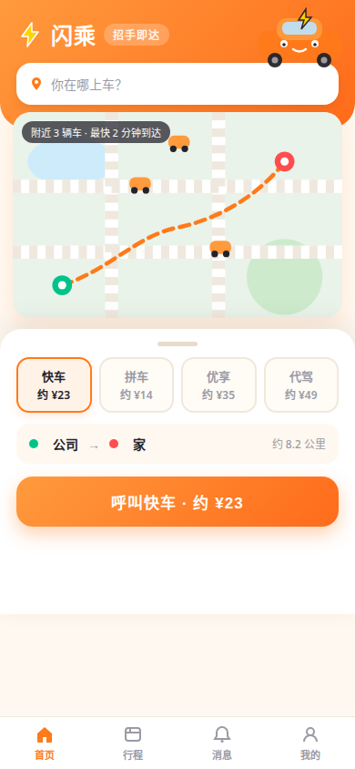
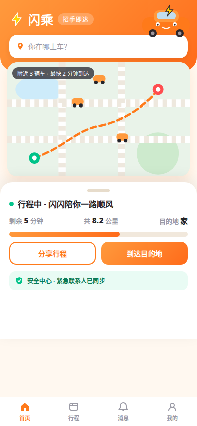
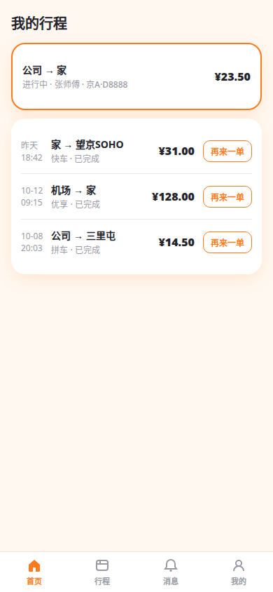
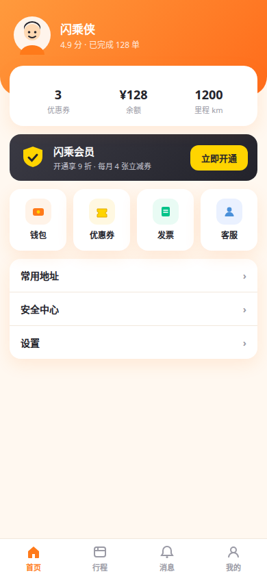

# 黏土风设计 Skill 🎨

> 把可爱黏土风 UI/UX 干货风格，沉淀为可直接用于 App 开发的设计提示词库。
> **v7** ｜ 31 个组件 ｜ 14 套风格 ｜ 92 张实测样图 ｜ 自动化流水线

---

## 效果图：实战项目「闪乘」打车 App

只给一个项目名「打车」，Skill 按自动化流水线 8 步全套生成：主题 → IA → 逐屏 Prompt → 可交互原型。
以下为原型真实渲染截图（黏土可爱风）：

| 首页·地图叫车 | 司机接单 | 行程中 |
|---|---|---|
|  |  |  |

| 到达评价 | 行程列表 | 消息中心 | 我的 |
|---|---|---|---|
|  |  |  |  |

原型包含完整可点流程：选车型 → 呼叫 → 司机接单 → 行程中 → 到达评价，以及行程 / 消息 / 我的三个 Tab。

---

## 这是什么

一套"从创意到整套 App 设计稿再到可运行代码"的提示词资产：

- **模式 A｜单组件设计**：说"设计一个 XX 组件"，直接拿到可投喂 AI 设计工具（即梦 / Midjourney / Figma AI 等）的完整 Prompt
- **模式 B｜黏土风内容**：3 问交互，输出社交媒体标题 + 封面 Prompt + 正文 + 标签
- **模式 C｜项目全案**：输入一个项目名，输出项目定位 → 主题规范 → 信息架构 → 逐屏设计 Prompt → 验收 → 可运行单文件 HTML → 打包清单

v7 新增**自动化流水线**：输入项目名，8 步自动跑完（品类识别 → 风格推荐 → 主题表 → IA → 组件映射 → 逐屏 Prompt → 封面 → 验收 → 代码），`scripts/scaffold.py` 一键生成项目骨架。

## 目录结构

```
.
├── SKILL.md                        # Skill 主文件：三种模式 + 工作流 + 规则
├── scripts/
│   └── scaffold.py                 # v7：一键项目脚手架（输入项目名 → 生成 pack 骨架）
├── showcase/                       # 实战项目效果图（闪乘打车 App 真实渲染）
└── references/
    ├── component-prompts.md        # 31 个组件的设计 Prompt 库（核心）
    ├── visual-dna.md               # 13 批样图沉淀的视觉 DNA：通用骨架 + 铁律
    ├── design-principles.md        # v7：设计师视角（选用决策树 / 风格指南 / 反模式 / 点评话术）
    ├── style-variants.md           # 14 套风格完整 token 表（颜色/圆角/阴影/字体/动效）
    ├── component-states.md         # v7：31 组件六态矩阵（默认/选中/禁用/空/加载/错误）
    ├── auto-pipeline.md            # v7：自动化流水线 8 步 + 品类映射表 + 吉祥物分配表
    ├── code-bridge.md              # 设计稿转可运行单文件 HTML
    ├── design-qa.md                # 10 项设计验收自检 + 打回重做机制
    ├── project-mode.md             # 项目全案模式说明
    ├── master-prompt.md            # 万能总提示词（贴给任何 AI 即用）
    ├── prompt-cards.md             # 6 种黏土风封面版式一键提示词卡
    ├── cover-prompt-template.md    # 封面公式模板
    ├── style-tokens.md             # 黏土风封面公式规范
    ├── content-taxonomy.md         # 内容选题分类
    ├── note-formula.md             # 笔记公式
    ├── worked-example.md           # 单组件示例
    ├── project-example-house-rental.md  # 项目全案示例·房屋出租
    ├── project-example-what-to-eat.md   # 项目全案示例·今天吃什么
    └── samples/                    # 92 张实测参考样图归档
```

## 快速开始

### 1. 设计单个组件（模式 A）

```
设计一个底部弹窗
```

→ 从 `component-prompts.md` 取对应卡片，填入主题变量，交付 UI 生成提示词。

### 2. 做一条黏土风内容（模式 B）

```
用黏土风做一条"会员卡片"
```

→ 3 问交互（做哪个组件 / 哪种封面版式 / 署名），交付标题 + 封面 Prompt + 正文 + 标签。

### 3. 做一个完整项目（模式 C / 自动化）

```bash
python3 scripts/scaffold.py "打车"
# → project-pack-打车.md：品类识别 → 风格推荐 → 主题表 → IA → 组件映射 → 逐屏 Prompt 骨架
```

→ 按骨架填血肉，走验收环，出可运行 HTML 原型。"闪乘"就是这样从零跑出来的。

## 组件库（31 个）

| # | 组件 | # | 组件 | # | 组件 |
|---|---|---|---|---|---|
| 01 | 启动页 | 12 | 性别/偏好选择 | 23 | 按钮/标签 |
| 02 | 启动图标 | 13 | 集卡 | 24 | 秒杀/拼团 |
| 03 | 底部 TAB | 14 | 天气/时间控件 | 25 | 顶部视觉 |
| 04 | 底部弹窗 | 15 | 付费订阅 | 26 | TAB 切换 |
| 05 | 主题配色 | 16 | 引导页 | 27 | 医疗/健康 |
| 06 | 搜索 | 17 | 卡片设计 | 28 | 异形弹窗 |
| 07 | 关键词筛选 | 18 | 发布页 | 29 | 表单输入 [通用] |
| 08 | 公告跑马灯 | 19 | 人脸识别 | 30 | 空状态与异常页 [通用] |
| 09 | 更新弹窗 | 20 | 排行榜单 | 31 | 订单卡片 [通用] |
| 10 | 个人主页 | 21 | PK 组件 | | |
| 11 | 积分签到 | 22 | 会员卡片 | | |

每个组件包含：定义 → 通用骨架 → 全部版式要点 → UI 生成提示词 → 黏土风封面公式 → 六态要求。

## 风格体系（14 套）

| 风格 | 一句话 | 适用 |
|---|---|---|
| 黏土可爱（默认） | 奶油底 + 番茄红 + 粗黑描边 + 白团子 | 社交、电商、工具 |
| 国潮风 | 宣纸 + 朱红 + 烫金 + 书法体 | 文旅、大促 |
| 暗黑霓虹 | 纯黑 + 荧光渐变 + 发光描边 | 音乐、游戏、电竞 |
| 极简奶油 | 米白 + 墨 + 大量留白 | 金融、效率、阅读 |
| 复古港风 | 米黄 + 港红港绿撞色 + 招牌字 | 餐饮、怀旧 |
| 新拟态 | 浅灰蓝同色 + 双向柔阴影 | 工具、健康、智能家居 |
| 手绘风 | 奶油黄 + 鸭黄 + ◆ 标题 + 鸭子 IP | 儿童、教育、宠物、运动 |
| Bento 格栅风 | 大小卡片严格网格 + 数据小组件 | 效率、金融总览、智能家居 |
| 液态玻璃 | 半透明玻璃材质 + 实时折射 + 胶囊控件 | 播放器、影像、系统工具 |
| 新丑风 | 3px 黑边框 + 硬阴影 + 高饱和撞色 | 开发者工具、潮牌、Z 世代 |
| 千禧复兴风 | 玻璃拟真 + 水滴气泡 + 蓝天渐变 | 天气、儿童、冥想、怀旧 |
| 多巴胺配色风 | 高饱和撞色 + 游戏化反馈 + 吉祥物 | 学习打卡、健身、大促 |
| 瑞士大字报 | 48pt+ 大标题 + 严格网格 + 纸媒感 | 阅读、作品集、买手店 |
| 扁平插画风 | 几何扁平插画 + 柔和渐变 + 治愈系 | 冥想、心理健康、女性向 |

每套风格在 `style-variants.md` 中配有完整 token 表（颜色 / 圆角 / 阴影 / 字体 / 动效），可直接落地代码。
选风格先看 `design-principles.md` 第 2 节《风格选用指南》。

## 设计铁律（摘要）

1. 版式结构、信息层级按参考 1:1 复刻；角色形象与文案一律原创替换
2. 所有 UI Prompt 默认：竖屏 9:19.5、中文界面、风格 token 行开头、末尾加状态句式
3. 封面黄色 `#FFD400` 只用于封面；中文大标题生图后叠加，不靠 AI 直出
4. 按钮文案永远是动词；选中态不只靠颜色；空状态必须有吉祥物 + CTA
5. 验收 10 项（溢出/对比度/错字是硬伤，出现即打回），同一问题打回两次就重写提示词

完整版见 `references/design-principles.md` 与 `references/design-qa.md`。

## 实测来源

- 92 张正文截图：用户提供的设计参考正文截图，逐批归档于 `references/samples/`，拆解为 13 批视觉 DNA
- 12 条公开笔记：公开可见的设计笔记标题与封面，拆出 6 种封面版式
- 标注 `[通用]` 的 3 个组件为行业通用规范，非实测

## 版本历史

- **v7**：设计师视角 / 风格 token 表 / 组件六态矩阵 / 自动化流水线 + 脚手架 / 31 组件
- **v6**：多风格体系 / 代码桥接 / 设计验收环 / 28 组件 / 92 样图
- **v5**：底部弹窗实测重写
- **v4**：真·视觉 DNA（3D 黏土风解码）
- **v1–v3**：封面公式 / 版式提示词卡 / 万能总提示词 / 项目全案模式

## 原则声明

本仓库只借鉴**版式结构、信息层级、配色逻辑、组件状态**等通用设计语言，
角色形象、IP、文案均为原创替换，**不复制、不搬运任何第三方的原稿、原图、原文案**。
组件名为通用词汇。仅供学习与原创设计使用。

## License

MIT
